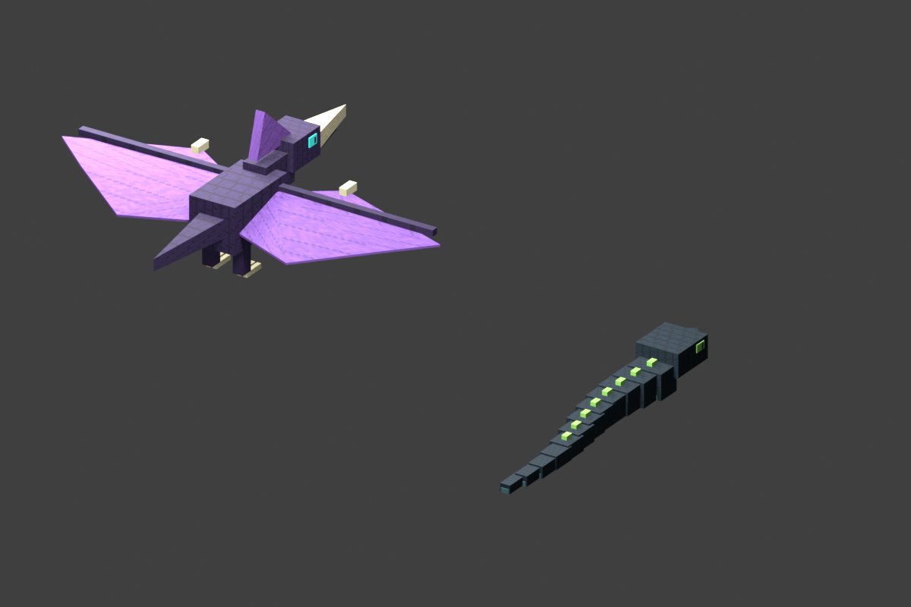
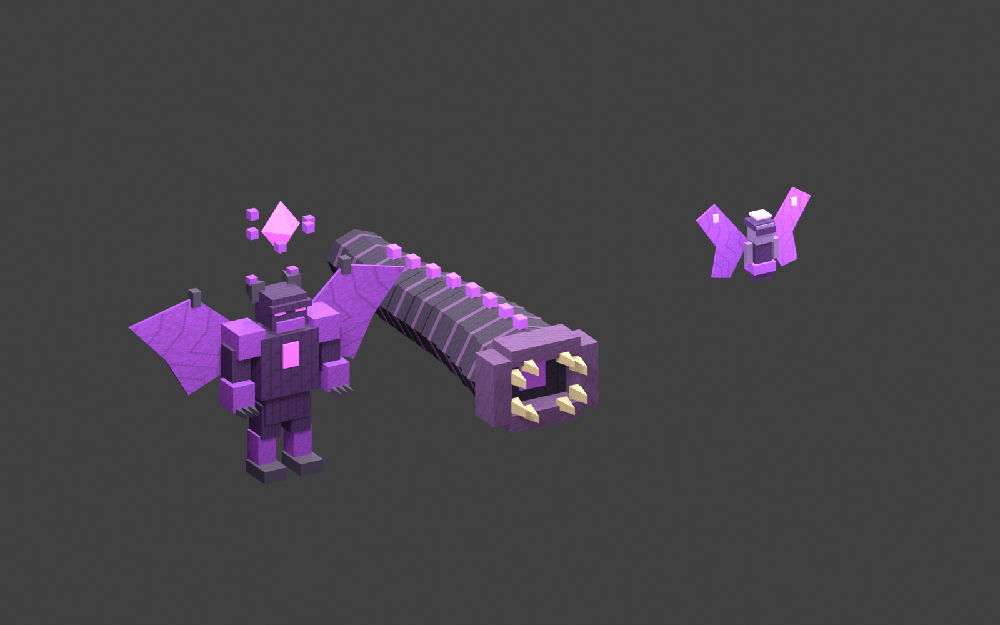

# Dimensional monster models

Original NasukoCustom geometry, pixel atlases and preview animation, authored with Blender MCP. Covered by the repository license. No upstream texture was modified.

Open `dimensional_monsters.blend` in Blender. Its dedicated scene contains a pterosaur and serpent, separate bone empties, pixel atlas materials, a preview camera and a 0–40-frame wing/slither animation. Texture paths point relatively to `../src/main/resources/assets/mystcraft/textures/entity/`.

To regenerate through Blender MCP, execute `tools/blender_dimensional_monsters.py` with `PROJECT_ROOT` set to the checkout's absolute path. It creates a separate scene, leaves existing objects untouched, restores the original active scene, and writes the .blend, atlases, meshes and `build/verification/dimensional-monsters/blender-preview.png`. It uses Blender's own modeling/image/render APIs.

Minecraft meshes are in `assets/mystcraft/models/entity/`. Format 1 stores per-part bone/pivot/emissive state and quads; each vertex contains `[x, y, z, u, v, nx, ny, nz]` relative to the bone pivot. Y is up, forward is -Z, coordinates are in blocks, UV origin is top-left. The renderer applies synchronized combat state and procedural bone animation; geometry is the exported Blender mesh.

## Two-/three-page reinforcements

`dimensional_reinforcements.blend` contains the purple fairy, large segmented worm, three-metre calamity and faceted explosive orb, with original pixel materials and bone animation. Regenerate it through Blender MCP by executing `tools/blender_dimensional_reinforcements.py` with `PROJECT_ROOT` set. It reuses the original script's modeling helpers without rewriting the first pair of creatures. The orb shares the calamity texture. Lasers and magic-circle meshes are drawn by the native runtime renderer.

